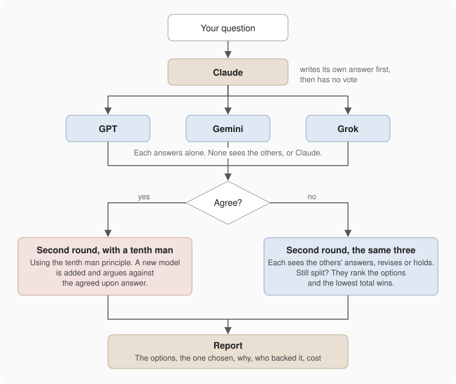

# mcp-roundtable

Give your question to several AI models and let them argue about it.

You ask Claude. Claude asks GPT, Gemini and Grok the same question, each one alone so they can't copy each other.
Then it shows every model what the others said and lets them change their minds. If they all agree, a fourth model
gets one job: assume they're wrong and find out why. You get a short report: the options, the one that won, why,
and who backed it.

It's an MCP server, so it plugs into Claude Code, claude.ai and Claude Desktop. The other models are reached through
[OpenRouter](https://openrouter.ai), one API for all of them. You bring your own key.



## An example

Question: a beginner who wants to cook better is buying one frying pan. Cast iron, carbon steel or non-stick?

Three models, three different answers in the first round. In the second round two of them swapped positions with
each other. Still no majority, so they ranked the options, and this came out:

| Option       | What it is                                                                   |
|--------------|------------------------------------------------------------------------------|
| Cast iron    | Heavy, holds heat, usually pre-seasoned, slow to respond                     |
| Carbon steel | Lighter, responds fast, seasoned like cast iron, thin pans can warp          |
| Non-stick    | Coated surface that releases food, cannot take high heat, wears out in years |

| Chosen                     | Why                                                                                              | Backed by                     | Confidence | Strongest counterargument                                                 |
|----------------------------|--------------------------------------------------------------------------------------------------|-------------------------------|------------|---------------------------------------------------------------------------|
| Carbon steel, pre-seasoned | Light and quick to respond, so it teaches heat control. Pre-seasoned removes the hard first step | Gemini 1st, Grok 1st, GPT 2nd | 8, 7, 7    | It often comes unseasoned, and that first step is where beginners give up |

Cost: about 0.06 USD. GPT 0.017, Gemini 0.019, Grok 0.023.

Nine chat calls, a couple of minutes. Two of the three models changed their answer along the way, which is the
point. The full discussion is still in the conversation if you want to read it.

## When to use it

Use it when you want a second opinion, or a third.

- A difficult problem, where you or a single model may land on an incorrect or suboptimal answer.
- A decision that is expensive to reverse: a schema, an API, an architecture.
- A field you do not know well, so you cannot judge the answer yourself.
- The end of a long day, when you are tired and want several models to check the work.

## What it does

The server is deliberately small. It gives Claude one way to talk to another model, and Claude runs the discussion
itself. The rules of a discussion are a prompt, not code.

| Tool          | What it does                                                                                                                                                                                      |
|---------------|---------------------------------------------------------------------------------------------------------------------------------------------------------------------------------------------------|
| `list_models` | Current models from OpenAI, Google, Anthropic, xAI and DeepSeek, newest first, with context size and supported thinking levels                                                                    |
| `chat`        | Sends a prompt to one model and returns the answer as is, with token usage. Optional `thinking` sets how hard the model reasons. Pass the returned `continuation_id` to continue the conversation |
| `version`     | The version of the server that is running. Also at `/version`                                                                                                                                     |

| Prompt      | What it runs                                                                                                                        |
|-------------|-------------------------------------------------------------------------------------------------------------------------------------|
| `consensus` | The discussion above. Several models answer an open question. If they agree, a tenth man has to find out why they're wrong          |
| `critic`    | Several models, each with its own focus such as security or maintenance, review something that exists. Claude answers every finding |

Model names are exact OpenRouter slugs, like `openai/gpt-6.1-sol`. No aliases such as "latest GPT", so you always know which model answered.

## Install

### 1. Create an OpenRouter key

Create a separate key for roundtable at [openrouter.ai/keys](https://openrouter.ai/keys) and give it a credit limit, say $5.

Your key passes through this server on every call. It's never stored or logged (conversations are tied to a SHA-256 hash of the key), but whoever runs the server could in theory read it. A dedicated key with a limit means a leak costs you at most the limit, and you can revoke it at any time.

### 2. Add the server

Pick one of the two options. If you set up both, Claude Code uses option 2 and hides the claude.ai connector, since they have the same URL.

#### Option 1: connector in claude.ai

Add a custom connector in claude.ai settings:

- URL: `https://mcp-roundtable.treceni.workers.dev/mcp`
- Authentication: No sign in
- Request headers: add one header
  - Name: `Authorization`
  - Value: `Bearer ` followed by your OpenRouter key, for example `Bearer sk-or-v1-abc123...`
    (the word Bearer, a space, then the whole key)

claude.ai caches the server's tool list. When the server gets new tools, open the connector and click refresh tool list, then start a new chat or a new Claude Code session. A resumed session (`--continue`, `--resume`) keeps the old list.

You do this once. The connector belongs to your account, so it shows up in claude.ai, Claude Desktop, the mobile apps and Claude Code (when it's logged in with your claude.ai account), on every computer. (Not tested yet whether the header reaches Claude Code. If it doesn't, use option 2 there.)

#### Option 2: Claude Code only

```bash
claude mcp add --scope user --transport http roundtable \
  https://mcp-roundtable.treceni.workers.dev/mcp \
  --header "Authorization: Bearer sk-or-..."
```

Use this if Claude Code runs on an API key instead of a claude.ai account. It only covers Claude Code on the computer where you run it, so repeat it on each machine. `--scope user` makes it available in every project. Run `claude mcp list` to check that it says Connected.

## Use

Ask Claude in plain words. It picks the tools.

```
Which Gemini models can roundtable reach?
```

```
Ask openai/gpt-6.1-sol and google/gemini-4-argon whether this migration
should use a single transaction. Show me where they disagree.
```

```
/roundtable:consensus Should we cache the model list in KV or in D1?
```

In Claude Code the prompts appear as slash commands under `/roundtable:`.

## Development

[CLAUDE.md](CLAUDE.md) has the setup, and the design decisions with what was rejected and why. The discussion
formats are specified in [docs/formats](docs/formats).
